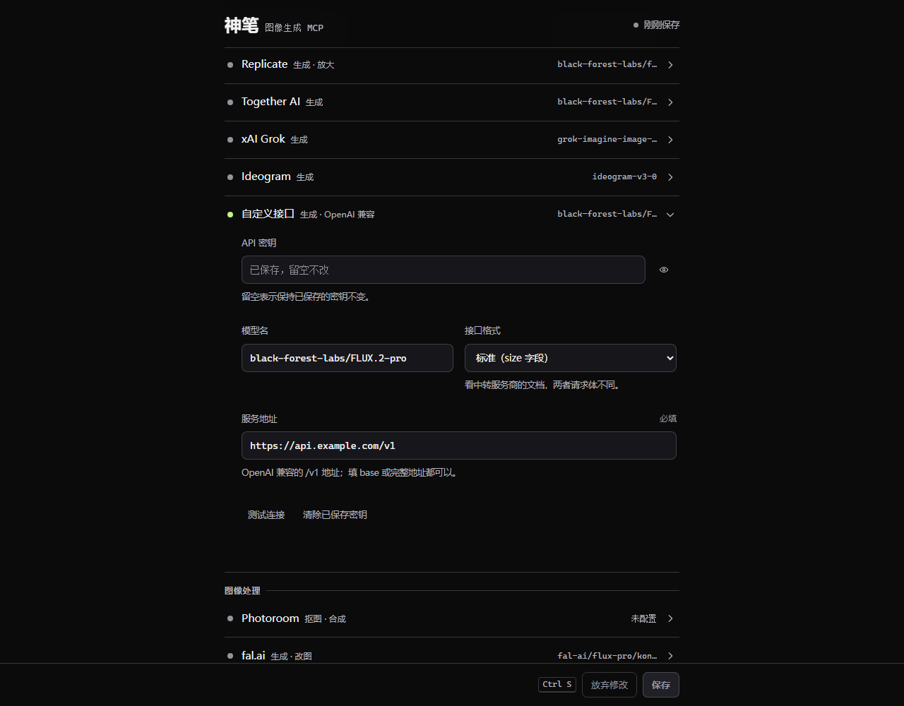

<div align="center">

# 神笔 · shenbi

**一个可执行文件，把六家图像模型的生成、改图、抠图、排版、放大、分析收进一个 MCP 接口，并配一个本地配置界面。**

Rust 重写 · 零运行时依赖 · 冷启动 < 1 秒 · 单文件 6.5 MiB

[](#环境要求)
[](#接入-claude-code)
[](LICENSE)
[](#工具全景)
[](#服务商矩阵)

</div>

---

## 三十秒上手

```powershell
cargo build --release
```

```powershell
.\target\release\shenbi.exe
```

浏览器自动打开 **http://127.0.0.1:7788** —— 粘贴 API Key、按 `Ctrl S`，再点底部「一键注册」。完成。

注册之后不必再手动启动：Claude Code / Claude Desktop 每次需要图像能力时会自己拉起 `shenbi mcp`。

不想点界面也行，一条命令搞定：

```powershell
shenbi install
```

手动配置的话，把下面这段写进 `.mcp.json` 即可：

```json
{
  "mcpServers": {
    "shenbi": {
      "type": "stdio",
      "command": "C:/path/to/shenbi.exe",
      "args": ["mcp"]
    }
  }
}
```

重启 Claude Code，然后直接说人话：

> 用 shenbi 生成一张 16:9 的咖啡店海报，暖调，电影感。

---

## 目录

- [打开配置界面](#打开配置界面)
- [界面一览](#界面一览)
- [接入 AI 客户端](#接入-ai-客户端)
- [为什么是神笔](#为什么是神笔)
- [工具全景](#工具全景)
- [服务商矩阵](#服务商矩阵)
- [资产预设](#资产预设)
- [一次请求的完整旅程](#一次请求的完整旅程)
- [工程实现细节](#工程实现细节)
- [配置参考](#配置参考)
- [实用示例](#实用示例)
- [与上游的差异](#与上游的差异)
- [性能与体积](#性能与体积)
- [二次开发](#二次开发)
- [许可](#许可)

---

## 打开配置界面

配置界面就是 `shenbi` 不带参数时的默认行为 —— **没有命令行开关要记，没有环境变量要背**。

| 场景 | 命令 | 说明 |
| --- | --- | --- |
| 打开配置（默认） | `shenbi` | 监听 `127.0.0.1:7788` 并打印地址 |
| 只开界面 | `shenbi ui` | 同上，语义更明确 |
| 换端口 | `shenbi ui --port 9000` | 端口被占用时用 |
| 只跑 MCP | `shenbi mcp` | stdio，无界面、无端口、无日志噪音 |
| 注册给 AI 客户端 | `shenbi install` | 之后每次自动启动，见[接入 AI 客户端](#接入-ai-客户端) |
| 不自动开浏览器 | `SHENBI_NO_BROWSER=1 shenbi` | 服务器 / 远程终端里用 |

界面在浏览器里就是一个静态页，**不联网、不加载 CDN、不发遥测**。它读写的唯一东西是本地配置文件：

```
~/.shenbi/config.json          # 默认位置
$SHENBI_CONFIG                 # 覆盖路径（CI、多套配置）
```

> **密钥不会因为打开界面就泄漏。** 服务端只回传「是否已配置」，从不回传密钥明文；输入框留空表示「保持原值不变」；由环境变量注入的密钥**永远不会写回磁盘**。

---

## 界面一览

<div align="center">

</div>

设计上只保留一件事：**让人尽快把 Key 填对**。

- **一行一个服务商**，左侧圆点就是状态灯 —— 灰＝未配置，绿＝已就绪。
- **点开才展开**，收起时整页只有九行；展开后是密钥、模型、编辑模型（或 Base URL）三个字段。
- **「测试连接」当场验证** —— 不是「保存后祈祷」，而是打一次真实鉴权请求，把上游的原话带回来：`API Key 无效（HTTP 401）：Incorrect API key provided: sk-inval***test`。
- **`Ctrl/⌘ S` 保存**，未保存时右上角状态点变实、底栏出现「还原」。
- **暗色 / 亮色自动跟随系统**，无手动开关。
- **键盘全程可用**：行标题是 `<button>` 带 `aria-expanded`，输入框有可见焦点环，`Tab` 顺序自然。

---

## 接入 AI 客户端

**注册一次，之后每次都能用。** MCP 是 stdio 服务：客户端（Claude Code / Claude Desktop）会在需要时自己拉起进程，所以注册只需要做一次，此后每次开新会话、每台机器上的每个项目都自动可用 —— 不需要先手动 `shenbi` 再连上去。

三种注册方式，任选其一：

### ① 界面一键注册（推荐）

打开配置界面，底部「接入 AI 客户端」点 **一键注册**。它会：

1. 检测本机是否装有 `claude` CLI，有则走官方 `claude mcp add --scope user`，由 CLI 校验并写入正确位置；
2. 没有 CLI 则直接合并进 `~/.claude.json` 的 `mcpServers`，**写入前自动备份**成 `~/.claude.json.bak-<时间戳>`；
3. 只改 `mcpServers.shenbi` 这一项，文件里其它配置原样保留。

按钮会实时显示状态：「已注册」/「更新注册路径」（已注册但指向旧路径）/「一键注册」。重开 AI 客户端即可用。

### ② 命令行注册

```powershell
shenbi install
```

| 命令 | 作用 |
| --- | --- |
| `shenbi install` | 注册到用户级（所有项目可用） |
| `shenbi install user` | 同上，语义明确 |
| `shenbi install project` | 只注册到当前目录的 `.mcp.json` |
| `shenbi uninstall` | 取消注册 |

注册后可用 `claude mcp list` 验证：

```
shenbi: D:/path/to/shenbi.exe mcp - ✔ Connected
```

### ③ 手动配置

```json
{
  "mcpServers": {
    "shenbi": {
      "type": "stdio",
      "command": "C:/path/to/shenbi.exe",
      "args": ["mcp"]
    }
  }
}
```

- 项目级：项目根目录的 `.mcp.json`
- 用户级：`~/.claude.json` 的 `mcpServers`
- Claude Desktop：`claude_desktop_config.json` 的 `mcpServers`

界面「手动配置」折叠区会把当前可执行文件的绝对路径填进去，点「复制」即可。

**MCP 走 stdio，不占端口、不开 socket，所以不存在「端口被占用」和「防火墙弹窗」。** 服务端日志只走 stderr，绝不污染 stdout 上的 JSON-RPC 流 —— 这是 MCP 实现最容易踩、也最容易让客户端直接超时卡死的坑。

---

## 为什么是神笔

### 商业价值

| 痛点 | 传统做法 | 神笔的做法 |
| --- | --- | --- |
| 十个服务商十套 SDK、十种返回格式 | 每个模型写一份适配 | 一个 `generate_image`，`provider` 换一个字符串 |
| 生成的图还要手工裁成头像/贴纸/标签 | 打开设计软件，手动裁 | `generate_asset` 一次调用直出成品尺寸 |
| 「把商品放到白底上、加柔和阴影」写了 40 行的 prompt | 靠模型碰运气 | `image_task` 用本地算子确定性完成，成本 ¥0 |
| 团队每个人的 Key、输出目录各存一份 | 散落在 shell 配置里 | 一个 `config.json`，界面可视化维护 |
| 图片流到外网就找不回来 | 只有聊天记录里的一张图 | 每次任务落盘 `.runs/<runId>/` + `manifest.json` 完整溯源 |
| 批量出图一条失败全废 | 重跑整批，重复计费 | 逐项隔离，失败项带结构化错误码单独返回 |

**能省的是真金白银**：模板快路径（`avatar`、`post_image`、`logo-cleanup`、`upscale-export` 等九种）完全不调用 LLM 规划器，也不产生模型调用 —— 一次「把这批商品图全裁成 1200×675 社媒图」的活，成本是 0，延迟是毫秒级。

### 技术优势

| 维度 | 实现 |
| --- | --- |
| **无运行时** | 不依赖 Node / Python / `sharp` 原生库 / libvips。双击就跑，拷贝到任何 Windows 机器就跑。 |
| **单文件分发** | Release 二进制 6.5 MiB，无 `.node`、无 `node_modules`、无动态库目录。 |
| **图像处理自研** | resize / crop / aspectCrop / circleMask / composite / palette 全部用 Rust `image` crate 实现，含 1px 抗锯齿的圆形遮罩、锚点定位、透明度混合。 |
| **协议层手写** | 直接实现 JSON-RPC 2.0 + MCP `2025-06-18` 的方法集（`initialize` / `tools/list` / `tools/call` / `ping`），没有中间框架，没有版本漂移。 |
| **失败可解释** | 所有错误是 `{code, message, retryable, suggestion}` 四元组。`TIMEOUT` / `PROVIDER_FAILURE` / `CONSTRAINT_VIOLATION` / `INPUT_TOO_LARGE` 可被调用方程序化处理，不靠正则解析报错文本。 |
| **计划先验证** | `image_task` 的 DAG 在执行前完成六项校验：重复 ID、终端节点、未知依赖、输出类型不一致、引用未定义、拓扑成环。 |
| **预算与延迟双闸** | `budget_cap_usd` 按注册表真实单价复算（不信规划器自报数字）；`latency_cap_seconds` 按**关键路径**而非总时长判定，并行分支不会被误杀。 |

### 便利程度

- **配置零文档**：界面里每一项都自带说明，密钥字段告诉你「已保存 · 留空不修改」。
- **诊断内建**：`list_capabilities` 会告诉你「在当前这套 Key 下，到底哪些 op + provider 组合真的能用」，配了单测连通性。
- **接入零摩擦**：界面「一键注册」直接写进 `~/.claude.json`（写入前自动备份，有 `claude` CLI 时优先走官方命令），之后每次自动启动；也可 `shenbi install` 一条命令完成。
- **失败不静默**：生成失败会附上 `availableProviders`；`image_task` 失败会给出完整 trace，告诉你哪个节点、为什么、能不能重试。

### 扩展性

**想接一个没内置的模型服务？大概率不用改代码。** 只要它是 OpenAI 兼容的 `/images/generations`（中转站、one-api、new-api、LiteLLM、SiliconFlow……），在界面「自定义接口」里填地址、Key、模型名即可 —— 见[自定义 API 接口](#自定义-api-接口)。

真要写死一个新服务商，也只是**一个 `match` 分支 + 一个 HTTP 函数**：

```rust
// src/providers.rs
async fn acme_generate(config: &Config, model: &str, prompt: &str, size: Size) -> Result<GeneratedImage, AppError> {
    let key = require_key(config, "acme")?;
    let body = json!({ "model": model, "prompt": prompt, "size": size.openai_dims() });
    let value = http::with_retries("acme generate", 2, |_| { /* POST */ }).await?;
    Ok(GeneratedImage { bytes: http::decode_b64(/* ... */)?, model: model.into(), revised_prompt: None })
}
```

再在 `generate()` 的 `match` 里加一行、`Config::default()` 里加一行默认模型、界面 `ORDER` 数组里加一个名字 —— 完事。注册表、工具 schema、界面开关全部自动跟上。

新增一个**能力算子**（不是生成类，是「对已有图做点什么」）同理：在 `capabilities::invoke` 里加一个 `(op, provider)` 分支，`registered_pairs()` 加一行，`image_op` 的工具枚举加一个值，规划器就能自动路由到它。

---

## 工具全景

| 工具 | 一句话 | 典型场景 |
| --- | --- | --- |
| `generate_image` | 文生图，可带风格前缀、尺寸、参考图 | 「生成一张 X」 |
| `generate_batch` | 批量文生图，并发可控，逐项隔离 | 「这 20 个词各来一张」 |
| `generate_asset` | 生成 + 按预设裁切，直接出成品 | 头像、封面、贴纸、Avery 标签 |
| `process_image` | 本地处理已有图片：缩放、裁剪、比例裁、圆遮罩 | 「把这张图裁成正方形」 |
| `image_op` | 直接调用单个能力（生成/改图/抠图/合成/放大/分析） | 「用 Photoroom 抠掉背景」 |
| `image_task` | 自然语言目标 → 规划 → 校验 → 执行 → 带 trace 返回 | 「把商品放白底加阴影」 |
| `list_capabilities` | 列出当前配置下真实可用的 op + provider | 「我到底能干什么」 |

### `generate_image` 的一个隐藏分支

传 `reference_image` 时，调用不会走文生图，而是**自动改走 OpenAI 的图像编辑模型**（默认 `gpt-image-1.5`）—— 参考图负责锚定构图、透视、光照，prompt 负责换内容。响应里会明确标注 `routedVia: "edit_prompt"`，不玩暗箱。

```json
{
  "prompt": "a golden retriever playing fetch on the beach",
  "reference_image": "C:/Pictures/lighting-ref.png",
  "size": "landscape"
}
```

### `image_task` 的两条路径

```
goal ──► 模板匹配 ──命中──► 直接执行（0 成本、毫秒级）
             │
             └──未命中──► Claude 规划器（Haiku）──► 校验 ──► DAG 并发执行
```

模板包含：九个资产预设 + `logo-cleanup` + `upscale-export` + `product-on-white` 式的合成流程。
未命中模板时才需要 `ANTHROPIC_API_KEY`；没有 Key 时给出明确指向（「去界面里加 Anthropic 的 Key」），而不是一句 `undefined is not a function`。

---

## 服务商矩阵

### 生成类（会产出全新像素）

| 服务商 | 默认模型 | 成本/次（估） | 备注 |
| --- | --- | --- | --- |
| **OpenAI** | `gpt-image-1` | $0.04 | 质量标杆；同时提供编辑模型通道 |
| **Google Gemini** | `gemini-3.1-flash-image` | $0.03 | 快、便宜、支持宽高比 |
| **Replicate** | `black-forest-labs/flux-1.1-pro` | $0.004 | 模型宇宙最大，任何 Replicate 模型都能填 |
| **Together AI** | `FLUX.1-schnell` | $0.003 | 最便宜的一档 |
| **xAI Grok** | `grok-imagine-image-2.0` | $0.02 | 忽略尺寸参数，会自动提示 |
| **Ideogram** | `ideogram-v3-0` | $0.08 | 文字渲染最强，适合带字海报 |
| **自定义接口** | 由你指定 | 由你的渠道决定 | 任意 OpenAI 兼容端点，见下节 |

### 自定义 API 接口

手里有中转站、自建 one-api / new-api / LiteLLM、或者 SiliconFlow 这类 OpenAI 兼容服务？不用改代码，界面里填三个字段就能当第 7 个服务商使用：

| 字段 | 例 |
| --- | --- |
| 接口地址 | `https://api.siliconflow.com/v1`（填到 `/v1` 或完整 endpoint 都行） |
| API Key | 你的令牌 |
| 模型名 | `black-forest-labs/FLUX.2-pro` |
| 接口格式 | `OpenAI 兼容（size）` 或 `SiliconFlow（image_size）` |

实现要点（`src/custom.rs`）：

- **地址归一化**：`https://host`、`https://host/v1`、`https://host/v1/images/generations` 三种写法都被识别为同一个 endpoint。
- **两种线格式**：OpenAI 系发 `{"size": "1024x1024"}`；SiliconFlow 系发 `{"image_size": "1024x576", "batch_size": 1}`，尺寸取它文档里的推荐分辨率。
- **响应兜底**：从 `data[0].b64_json`、`data[0].url`、`images[0].url` 以及裸字符串 URL / data URL 里都能取到图 —— 中转站们在这点上百花齐放。
- **连通性探测**：点「测试连接」会请求 `/models`，返回上游原话。
- 统计成本时按 0 计（渠道价格未知，宁可少报不虚构）。

### 能力类（对已有图片动手）

| 服务商 | 能力 | 说明 |
| --- | --- | --- |
| **OpenAI** | `edit_prompt` | 指令改图，支持尺寸 |
| **Photoroom** | `extract_subject` / `composite_layers` | 商用级抠图；带 AI 阴影与背景生成的商品排版 |
| **fal.ai** | `edit_prompt` | Flux Kontext，排队协议含轮询与超时取消 |
| **Replicate** | `enhance_upscale` | Real-ESRGAN，2× / 4×，4MP 输入上限、16MP 输出上限 |

### 本地能力（不发一个网络请求）

| 能力 | 实现 | 成本 |
| --- | --- | --- |
| `transform` | resize（cover/contain/fill、可禁放大）、crop、aspectCrop（五种 gravity）、circleMask | 0 |
| `composite_layers` | 多图层合成、五种锚点、缩放、透明度、任意画布底色 | 0 |
| `analyze_dimensions` | 宽高、格式、通道、是否带 alpha | 0 |
| `analyze_palette` | 主色板（8-bit 量化分桶，带权重），1–16 色 | 0 |

---

## 资产预设

一次调用，直出可用尺寸 —— 不用再去设计软件里拖框。

| 预设 | 输出 | 后处理链 |
| --- | --- | --- |
| `profile_pic` | 200×200 圆形 | 1:1 居中裁 → 圆遮罩 → 缩放 |
| `avatar` | 80×80 圆形 | 同上 |
| `post_image` | 1200×675 | 16:9 裁切 → 缩放 |
| `scene` | 1200×675 | 同上 |
| `hero_photo` | 1080×1920 | 9:16 裁切 → 缩放（禁放大） |
| `avery_8293` | 450×450 圆形 | 1.5″ 圆标 |
| `avery_22830` | 750×750 圆形 | 2.5″ 圆标 |
| `avery_5160` | 788×300 | 地址标签，cover 填充 |
| `avery_8164` | 1000×1200 | 3:4 裁切 → 缩放，货运标签 |

> 后处理失败时**不会丢掉已付费的生成结果** —— 会把原图以 `_raw.png` 落盘并返回 `warning`，钱不会白花。

---

## 一次请求的完整旅程

以 `image_task` 为例：

```
①  goal + input_images + constraints
        │
②  template? ──yes──► 用模板生成 DAG
        │no
        └──► 把「当前可用的 op×provider 快照」塞进 system prompt，
             让 Claude 只在这个范围内选，返回纯 JSON
        │
③  validate_plan()
     ├─ 节点 ID 唯一
     ├─ terminalNodeId 存在且是图像节点
     ├─ dependsOn 全部存在
     ├─ outputKind 与 op 匹配（analyze_* 必须声明 data）
     ├─ $inputs.x / $nodes.y.output 引用可解析
     └─ 拓扑排序无环（Kahn）
        │
④  budget_cap_usd ?  → 用注册表单价复算，超限即拒
   latency_cap_seconds ? → 按关键路径复算，超限即拒
        │
⑤  dry_run ? ──yes──► 只返回计划、成本、延迟估算，不花钱
        │no
⑥  按依赖就地执行：就绪节点并发跑，失败节点把下游标记 skipped
        │
⑦  终端节点产物复制到目标路径（命名规则统一）
        │
⑧  写 .runs/<runId>/manifest.json（节点、耗时、成本、错误）
        │
⑨  返回 { success, output:{path}, plan, trace[], total_cost_usd, skips[] }
```

第 ⑨ 步的 `trace` 是**结构化**的，每个节点带 `status / latency_ms / cost_usd / output_path / error{code,retryable}` —— 客户端可以直接渲染成时间线，而不是让模型再解析一遍自然语言。

---

## 工程实现细节

### 写盘永远原子

```rust
tokio::fs::write(&tmp, data).await?;
tokio::fs::rename(&tmp, path).await?;
```

生成中途断电、进程被 kill、磁盘写满，都不会留下半张损坏的 PNG 顶替掉一张好图。

### 重试只重试该重试的

- 5xx / 429 / 网络抖动 → 指数退避重试（1s → 2s → 4s，上限 2 次）
- 内容策略拦截（200 但无图）→ **不重试**，避免白烧 ~$0.12 和 4 分钟
- 4xx 参数错误 → 立刻失败，带上游原文

### 并发是收敛的，不是放飞

- `generate_batch`：按 `max_concurrent`（1–8，默认取配置）分块并发，块内 `Promise.all` 语义，块间串行
- `image_task`：同批就绪节点并发执行，受依赖图约束
- 每项独立 `AppError`，单点失败不连坐

### 超时是分层的

| 层 | 默认 | 可调 |
| --- | --- | --- |
| HTTP 连接 | 20 s | 固定 |
| 单次请求 | 300 s | 界面「高级 → 请求超时」 |
| Replicate 轮询 | 请求超时值 | 超时前主动 `cancel`，**停止计费** |
| fal 队列 | 90 s | 超时报错，不无限等 |

### 溯源可查

```
~/Downloads/generated-images/
├── 2026-11-23-image-task-product-shot-a1b2c3.png    # 成品
└── .runs/
    └── run-2026-11-23T09-04-11-123Z-a1b2c3/
        ├── nscene.png        # 中间产物，可复现每一步
        ├── ncomposite.png
        └── manifest.json     # 计划、节点、耗时、成本、错误详情
```

启动时按「任务记录保留小时数」清理过期 run 目录，不会无限增长。

### 路径是收口的

- 所有输出路径先 `resolve` 再 `mkdir -p`，绝不写到意料之外的目录
- `assetId` 经 `basename` + 白名单字符过滤，挡住 `../../` 穿越
- 可选的「输入白名单目录」开启后，所有输入图片必须 `canonicalize` 后落在该目录内，软链也逃不出去
- 所有 PNG 输出后缀强校验，不会把 `.png` 写成别的东西

### 配置界面只信自己

- 只绑定 `127.0.0.1`，不监听 `0.0.0.0`
- 额外校验 `Host` 头必须是 loopback，**挡住 DNS rebinding**（攻击者把自己域名解析到 127.0.0.1 来读你的 Key）—— 非法 Host 直接 403
- 密钥回传面为零：`/api/config` 只返回 `configured: true/false`
- 环境变量注入的密钥在保存时被剥离，永不落盘

---

## 配置参考

`~/.shenbi/config.json`：

```json
{
  "default_provider": "openai",
  "output_dir": "~/Downloads/generated-images",
  "input_root": "",
  "run_retention_hours": 24,
  "max_concurrent": 3,
  "request_timeout_ms": 300000,
  "providers": {
    "openai": { "api_key": "", "base_url": "", "model": "gpt-image-1", "edit_model": "gpt-image-1.5" },
    "gemini": { "api_key": "", "base_url": "", "model": "gemini-3.1-flash-image", "edit_model": "" }
  }
}
```

### 字段

| 字段 | 默认 | 说明 |
| --- | --- | --- |
| `default_provider` | `openai` | 未指定 provider 时用它；不可用则自动退到第一个已配置的 |
| `output_dir` | `~/Downloads/generated-images` | 产物目录，支持 `~` |
| `input_root` | 空 | 输入白名单根目录；空＝不限制 |
| `run_retention_hours` | `24` | `.runs` 保留时长；`0`＝不清理 |
| `max_concurrent` | `3` | 批量默认并发（1–8） |
| `request_timeout_ms` | `300000` | 单次上游请求超时（5 s–600 s） |
| `providers.*.base_url` | 空 | 空＝官方地址；填了则走代理或兼容网关 |
| `providers.custom.format` | `openai` | 自定义接口的线格式：`openai` 或 `siliconflow` |

### 环境变量（优先级高于文件）

| 变量 | 作用 |
| --- | --- |
| `SHENBI_CONFIG` | 配置文件路径 |
| `SHENBI_DEFAULT_PROVIDER` | 覆盖默认服务商 |
| `SHENBI_OUTPUT_DIR` | 覆盖输出目录 |
| `SHENBI_INPUT_ROOT` | 覆盖输入白名单 |
| `SHENBI_NO_BROWSER` | 设为任意值则启动界面时不自动打开浏览器 |
| `OPENAI_API_KEY` | OpenAI |
| `OPENAI_DEFAULT_MODEL` / `OPENAI_EDIT_MODEL` | 模型名 |
| `GEMINI_API_KEY` | Gemini |
| `REPLICATE_API_TOKEN` | Replicate |
| `TOGETHER_API_KEY` | Together |
| `XAI_API_KEY` | Grok |
| `IDEOGRAM_API_KEY` | Ideogram |
| `PHOTOROOM_API_KEY` | Photoroom |
| `FAL_KEY` | fal.ai |
| `ANTHROPIC_API_KEY` | `image_task` 规划器 |

> **没有 Key 也能跑。** 本地算子（裁切、合成、分析、资产预设）完全不依赖任何服务商 —— 装上就能用。

---

## 实用示例

### 生成 + 直出社媒封面

```json
{
  "name": "generate_asset",
  "arguments": {
    "prompt": "minimal coffee shop opening poster, warm light, film grain",
    "assetType": "post_image",
    "provider": "openai",
    "assetId": "coffee-opening"
  }
}
```

→ `~/Downloads/generated-images/coffee-opening.png`，1200×675，一步到位。

### 批量出图，失败不连坐

```json
{
  "name": "generate_batch",
  "arguments": {
    "items": [
      { "prompt": "a red fox in snow, digital painting" },
      { "prompt": "a lighthouse at sunset, oil painting" },
      { "prompt": "a bowl of ramen, studio food photography" }
    ],
    "provider": "replicate",
    "size": "landscape",
    "max_concurrent": 3
  }
}
```

响应里 `summary: {total: 3, succeeded: 2, failed: 1}`，失败项带 `error.code`，其余两张照常落盘。

### 先看计划，再花钱

```json
{
  "name": "image_task",
  "arguments": {
    "goal": "product photo on a clean white surface with a soft shadow",
    "input_images": ["C:/shots/bottle.jpg"],
    "constraints": { "output_size": "square", "budget_cap_usd": 0.05 },
    "dry_run": true
  }
}
```

返回计划、每步成本、总成本、关键路径延迟 —— 确认划算再摘掉 `dry_run` 重跑。

### 只抠图，不要新像素

```json
{
  "name": "image_op",
  "arguments": {
    "op": "extract_subject",
    "provider": "photoroom",
    "params": { "input": "C:/shots/bottle.jpg" }
  }
}
```

### 把一张图裁成头像并圆角

```json
{
  "name": "process_image",
  "arguments": {
    "inputPath": "C:/shots/me.jpg",
    "operations": [
      { "type": "aspectCrop", "ratio": "1:1", "gravity": "north" },
      { "type": "circleMask" },
      { "type": "resize", "width": 512, "height": 512 }
    ]
  }
}
```

---

## 与上游的差异

本项目基于 [thebenlamm/image-gen-mcp](https://github.com/thebenlamm/image-gen-mcp) 的**工具契约**用 Rust 完整重写，不是翻译。

**保留**：七个工具名、参数名、响应字段（`success` / `path` / `provider` / `model` / `trace` / `runId` 等）、资产预设、`$inputs.x` 与 `$nodes.y.output` 引用语法、run 目录结构语义。

**改进**：

| 项 | 上游 | 神笔 |
| --- | --- | --- |
| 运行时 | Node 22 + `sharp` + `node-gyp` | 无，单文件 6.5 MiB |
| 冷启动 | 数百毫秒（含模块加载） | 约 10 ms（本地磁盘热态） |
| 配置 | `.env` + `export` + 手改 `.mcp.json` | 本地 Web UI + 连通性自测 |
| 图像处理 | sharp（libvips 原生依赖） | 纯 Rust `image` crate |
| 延迟闸 | 未实现 `latency_cap_seconds` 的判定 | 按关键路径判定 |
| 密钥落盘 | 环境变量读取后无剥离逻辑 | 环境变量密钥永不写回文件 |
| 本地界面安全 | 无 | loopback 绑定 + Host 头校验 |

**尚未覆盖**（诚实说明）：

- **OCR**（上游 `analyze_ocr: tesseract`）—— 需要引入 Tesseract 原生库，会破坏「零运行时依赖」这个最大卖点，故暂缓。
- **SSE 传输** —— 目前仅 stdio。MCP 生态主流客户端（Claude Code / Desktop）都走 stdio，SSE 属于长尾需求。
- **能力评测框架**（上游 `npm run eval`）—— 属于研发期工具，不影响交付能力。

这三项都在路线图上，欢迎 PR。

---

## 性能与体积

| 指标 | 实测值 |
| --- | --- |
| Release 二进制 | **6.5 MiB** |
| 直接依赖 | 8 个 |
| 传递依赖 | 231 个（`Cargo.lock`） |
| CLI 冷启动 | 首次 131 ms（冷缓存），之后 **9–10 ms** |
| MCP 握手（`tools/list` 全流程） | 约 140 ms（含进程启动） |
| 配置界面可用 | 约 0.6 s（含进程启动，热态） |
| 源码规模 | 4,209 行 Rust + 697 行前端（单文件，无构建步骤） |

前端没有 npm、没有打包器、没有框架 —— 一个 `include_str!` 嵌进二进制里的 HTML，改完 `cargo build` 就生效。

---

## 二次开发

```powershell
cargo build            # debug
cargo build --release  # 发布
cargo run -- ui --port 7788
```

### 目录结构

```
src/
├── main.rs          入口：ui / mcp 两个模式，配置加载，run 清理
├── config.rs        配置结构、环境变量覆盖、密钥剥离、保存
├── mcp.rs           JSON-RPC 2.0 + MCP 方法集、7 个工具的 schema 与实现
├── providers.rs     六家生成服务商 + OpenAI 编辑通道
├── capabilities.rs  能力注册表与 8 类 op 的实现
├── task.rs          模板、Claude 规划器、计划校验、DAG 执行
├── custom.rs        OpenAI 兼容自定义端点：地址归一、两种线格式、响应兜底
├── install.rs       MCP 注册/注销：优先 claude CLI，否则合并 ~/.claude.json 并备份
├── imaging.rs       图像算子：缩放、裁剪、圆遮罩、合成、调色板
├── output.rs        输出路径解析与原子落盘、输入白名单
├── presets.rs       九个资产预设及其后处理链
├── runs.rs          run 目录、manifest、保留期清理
├── http.rs          共享 HTTP 客户端、重试、错误归一
├── error.rs         结构化错误码
├── util.rs          时间戳、runId、slugify、原子写
└── ui/
    ├── mod.rs       axum 路由、配置读写 API、服务商探测、Host 校验
    └── index.html   单文件界面（无构建步骤）
```

### 加一个新服务商（四步）

1. `config.rs` 的 `Config::default()` 里加一行默认模型
2. `providers.rs` 写一个 `xxx_generate()`，并在 `generate()` 的 `match` 里加一行
3. `providers.rs` 的 `default_model()` 加一个兜底分支
4. `ui/index.html` 的 `LABELS` 与 `ORDER` 各加一项

### 加一个新算子（三步）

1. `capabilities.rs` 的 `invoke()` 加一个 `(op, provider)` 分支
2. `registered_pairs()` 加一行（决定 `list_capabilities` 是否展示、规划器能否路由到它）
3. `mcp.rs` 的 `image_op` 工具枚举加一个值

---

## 环境要求

- **运行**：Windows 10/11 x64（也可在 Linux/macOS 上用 `cargo build --release` 自行构建）
- **构建**：Rust 1.75+，无需 MSVC 之外的原生工具链

## 许可

[MIT](LICENSE)。工具契约与产品构思源自 [thebenlamm/image-gen-mcp](https://github.com/thebenlamm/image-gen-mcp)（同样 MIT），实现独立重写。

<div align="center">
<sub>神笔 —— 下笔有神</sub>
</div>
